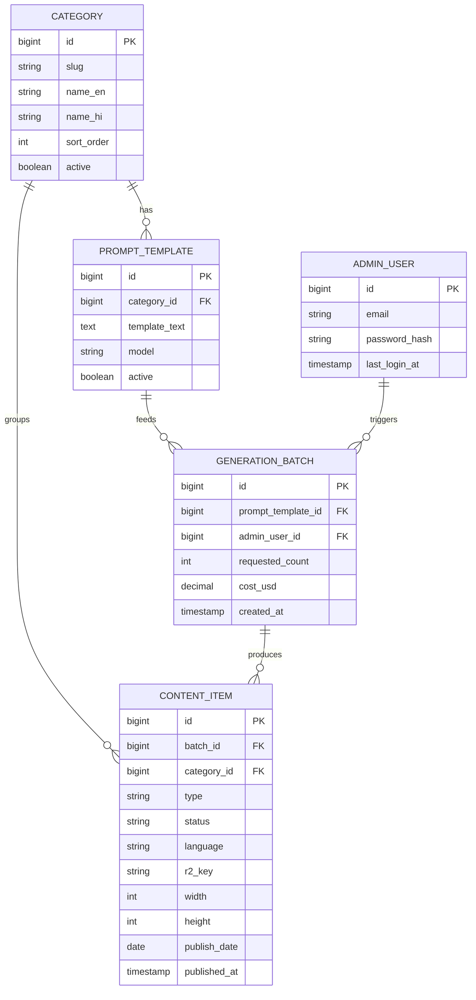

# Stotram backend

Java Spring Boot server for Stotram — a free devotional status platform. This one application does three jobs:

1. **Public feed API** — read-only JSON consumed by the website (and later the Android app)
2. **Admin API** — the generate → review → publish workflow, used by the `/admin` panel in the frontend
3. **Daily content pipeline** — a scheduled job that generates AI image candidates for human review

There is deliberately no user system, no uploads from users, no PII. The public surface is read-only.

---

## 1. System architecture

```
Clients                      Cloudflare (free tier)              Origin
─────────────────────        ──────────────────────────          ─────────────────────────
Website (React/Pages) ─────▶ CDN cache ────────────────────────▶ R2 bucket (images + feed)
Android app (later)   ─────▶ DNS + TLS  api.stotram.* ─────────▶ VPS: Spring Boot ─▶ PostgreSQL
Admin browser         ─────▶ Access (login gate for /admin) ───▶ VPS: Spring Boot (admin API)
```

- **Media never touches the VPS.** Images are served from Cloudflare R2 via CDN with a custom domain (e.g. `cdn.stotram.app`). R2 has zero egress fees — this is the load-bearing cost decision; bandwidth is what kills status apps at scale.
- The VPS (Hetzner / DigitalOcean Bangalore, ~₹450–700/mo) runs exactly two processes: Spring Boot and PostgreSQL.
- `api.stotram.*` is proxied through Cloudflare (DNS + TLS). The app ships pointing at the domain, never a raw IP, so the VPS can be swapped without breaking installed clients.
- The feed response changes once per day → set long CDN cache headers. The origin can survive massive traffic because Cloudflare absorbs it.

## 2. Daily content pipeline

Runs inside this Spring Boot app via `@Scheduled` — no extra infrastructure.

```
Daily 5 AM cron (Spring scheduler)
  → Generate ~25 candidate images via AI image API   (pay-per-image, ~$0.005–0.03/img)
  → Human review in admin panel: approve ~10, reject the rest   ← THE non-negotiable step
  → Post-process approved: watermark ("Stotram") + compress to WebP
  → Publish: upload to R2 + insert/update rows + rebuild feed.json
```

Pipeline rules:

- **Every image is human-reviewed before publishing.** AI frequently gets deity iconography wrong (wrong number of arms, wrong attributes). One bad image = uninstalls and worse. Generate 25, hand-pick ~10.
- Prompts live in the DB (`prompt_template`), not in code — tunable from the admin panel without redeploying.
- Every batch records its cost (`generation_batch.cost_usd`) so per-image economics are visible from day one.
- Watermark matters: with no ads, shared statuses are the only growth channel.
- Output images sized for WhatsApp status: portrait, e.g. 1080×1350 or 1080×1920, WebP.
- Audio/music is a video-phase concern; when videos come, use only royalty-free/original audio (music copyright strikes kill Play Store listings).

## 3. Data model

Five tables. `content_item` is the heart; `type` exists so videos can be added later without schema surgery.



Table notes:

- **content_item** — one row per image. `type` = `IMAGE` (later `VIDEO`). `status` lifecycle:
  `GENERATED → APPROVED → PUBLISHED` (or `REJECTED`; later `ARCHIVED` when rotating old content out).
  `r2_key` is the object key in the bucket; the public URL is `https://cdn.<domain>/<r2_key>`.
  `publish_date` = which day's feed the item belongs to.
- **category** — `good-morning`, `good-night` at launch; festivals later. Localized names (`name_en`, `name_hi`, add columns/table per language as languages grow) so the UI localizes from data, not code.
- **prompt_template** — generation prompts per category, editable from admin. `model` records which image model.
- **generation_batch** — one row per pipeline run (scheduled or manual), with cost tracking.
- **admin_user** — exactly one row to start. Password stored as bcrypt hash.

## 4. API surface

### Public (read-only, CDN-cacheable)

```
GET /api/feed?lang=hi&category=good-morning&page=0
```

Returns published items, newest first:

```json
{
  "items": [
    {
      "id": 123,
      "type": "image",
      "url": "https://cdn.stotram.app/2026/08/06/gm-hi-01.webp",
      "width": 1080,
      "height": 1350,
      "category": "good-morning",
      "lang": "hi",
      "date": "2026-08-06"
    }
  ],
  "nextPage": 1
}
```

This contract is shared with the frontend via TypeScript types (`shared/` if monorepo-ing later). `url` always points at the CDN domain, never the VPS.

### Admin (behind Cloudflare Access + Spring Security)

```
GET  /admin/blocks · /admin/blocks/options # generation blocks (prompt + category + lang + model + images/run)
POST /admin/blocks · PUT/DELETE /admin/blocks/{id}   # manage blocks; DELETE archives
POST /admin/blocks/bulk                   # create many blocks at once (shared settings + [{name, prompt}])
GET/PUT /admin/principle                  # the saved principle prompt (master instruction)
POST /admin/principle/write               # {prompt, count, category} -> LLM drafts N block prompts (not saved)
POST /admin/blocks/{id}/generate          # run one block (202, images land as GENERATED)
POST /admin/blocks/generate-all           # run every active block (max 200 images per click)
GET  /admin/candidates?status=GENERATED   # thumbnails awaiting review
POST /admin/candidates/{id}/approve
POST /admin/candidates/{id}/reject
POST /admin/candidates/{id}/reject        # also takes a PUBLISHED item down from the feed
POST /admin/candidates/{id}/edit          # {prompt, model?} -> NEW candidate edited from the clean original (sync, ~20-60 s)
POST /admin/publish                       # "Publish now": all APPROVED -> PUBLISHED (publish_date = today IST)
GET  /admin/publish/schedule              # auto-publish job: enabled, cron, next/last run
PUT  /admin/publish/schedule              # {enabled, cron} — Spring 6-field cron, Asia/Kolkata; re-registers live
POST /admin/login · GET /admin/me · POST /admin/logout
```

## 5. Security

- **Public attack surface is tiny by design**: read-only endpoints, no user data, no PII. The one asset to protect is the write path (someone publishing offensive content to the audience).
- All write endpoints live under `/admin/**`:
  - **Cloudflare Access** (free ≤50 users) in front of the admin hostname — Google login required before requests even reach the VPS.
  - Plus Spring Security session login (**built**): `POST /admin/login` with `{email, password}` → `STOTRAM_SESSION` cookie (HttpOnly, SameSite=Strict, Secure via `SESSION_COOKIE_SECURE=true` in prod). `GET /admin/me`, `POST /admin/logout`. Single admin from `ADMIN_EMAIL` / `ADMIN_PASSWORD` env vars, stored as a **bcrypt** row by `AdminBootstrap` on startup (never in git; change the env var + restart to rotate). **Rate-limited**: 5 failures per client → 15 min cooldown (429).
- **VPS**: SSH key auth only, password login disabled (the #1 way small VPSes get owned).
- **Secrets** (R2 keys, image-API key, DB password): env vars on the server only. The mobile/web clients contain zero secrets — they only read public URLs.

## 6. Hosting & ops

| Piece | Choice | Cost |
|---|---|---|
| VPS | Hetzner or DO Bangalore, 1 small instance | ₹450–700/mo |
| DB | PostgreSQL on the same VPS | ₹0 |
| Media + feed | Cloudflare R2 + CDN, custom domain | ~₹0 at this scale (zero egress) |
| AI images | Pay-per-image API (~$0.005–0.03/img), 300–750/mo | ₹200–1,500/mo |
| Domain | any registrar, DNS on Cloudflare | ~₹1,000/yr |

DNS layout: `api.*` → VPS (proxied), `cdn.*` → R2 custom domain, apex/`www` → Cloudflare Pages (frontend + privacy policy — Play Store requires a privacy policy URL even with no login).

## 7. Build order

1. Spring Boot skeleton + Postgres + Flyway migrations for the five tables
2. Image generation client + `@Scheduled` batch job (candidates land as `GENERATED`)
3. Admin API: candidates list, approve/reject
4. Post-process (watermark + WebP) and publish step (R2 upload + feed rebuild)
5. Public feed endpoint with cache headers
6. Deploy: VPS + Cloudflare DNS/Access/R2

Milestone 1 = the generate → review → publish loop working end-to-end locally. That's also the go/no-go test for whether AI image quality is good enough — the only real product risk.

## 8. Explicitly out of scope (for now)

- AI **video** generation (cost + iconography risk). Videos later = FFmpeg zoom/pan over approved images + royalty-free audio, ≤30s, 9:16, 720×1280 (WhatsApp status limits).
- Ads/monetization — nothing at launch. Later: native in-feed ads (never aggressive banner refresh — AdMob invalid-traffic bans) and festival sponsorships.
- User accounts, uploads, comments, analytics beyond basic counters.
